  

  <b>StreamOrchard</b> makes desktop apps for people who watch a lot of live streams. 
  Watch them side by side, collect your drops while you do, and let the apps talk to each other, all on your own computer.

 

  <a href="https://github.com/GlowingPear/stream-window-multiview/releases/latest"><b>Download</b></a>
  &nbsp;·&nbsp; <a href="https://github.com/GlowingPear/stream-window-multiview">Source</a>
  &nbsp;·&nbsp; Windows, macOS and Linux

 

  <a href="https://github.com/StreamOrchard/pear-drops/releases/latest"><b>Download</b></a>
  &nbsp;·&nbsp; <a href="https://github.com/StreamOrchard/pear-drops">Source</a>
  &nbsp;·&nbsp; Windows and macOS, or Linux from source

 

  With both apps open, Pear Drops tells Stream Multiview when it's farming, so multiview's Kick players 
  sign out and leave the drop credit to Pear Drops. Any app can join in.

  <code>npm install @streamorchard/grapevine</code>
  &nbsp;·&nbsp; <a href="https://github.com/StreamOrchard/grapevine">Source</a>
  &nbsp;·&nbsp; <a href="https://github.com/StreamOrchard/grapevine/blob/main/PROTOCOL.md">The protocol</a>

 

  Free and open source under the GPL-3.0 &nbsp;·&nbsp; Not affiliated with or endorsed by Kick, Twitch, YouTube or Rumble

